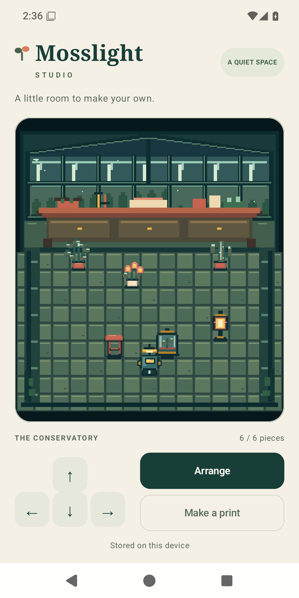
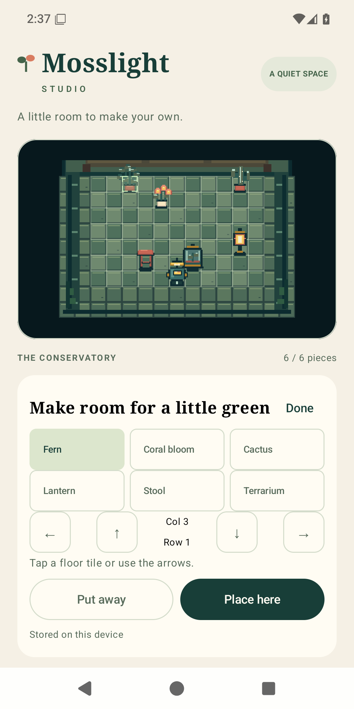
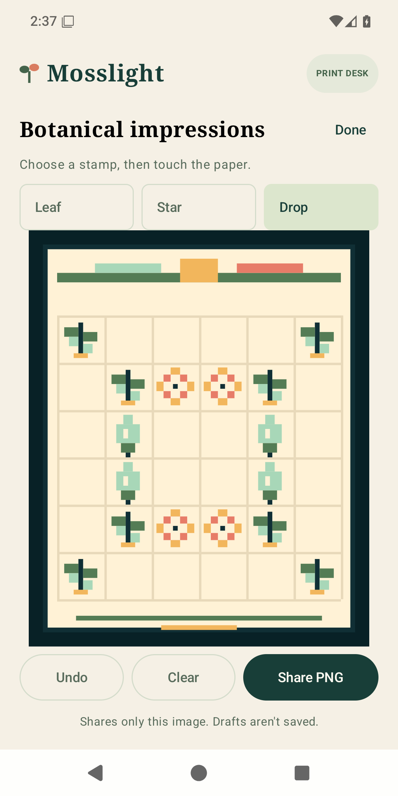

# Mosslight Studio

A small Android conservatory you can arrange, explore, and turn into a botanical pixel print.

Mosslight Studio is a deliberately compact Kotlin portfolio project. Its one room brings together a Canvas renderer, Compose controls, deterministic movement, durable local layouts, and an Android PNG share flow. The caretaker is a little lamp-bot; the six pieces and all illustrations are drawn from code.

<p>
  
  
  
</p>

## Try it

1. Tap a direction to step, or hold to move around the room.
2. Choose **Arrange**. Select one of six objects, tap a floor tile or use the coordinate arrows, then **Place here**. Occupied cells and the caretaker's position are protected. **Put away** removes an object; selecting it again makes it available to place.
3. Choose **Make a print**. Add leaf, star, and drop stamps to the paper, undo changes, and share a PNG through Android's chooser.

Layouts stay on the device. Print drafts survive activity recreation but are intentionally session-only. No account, network connection, or external asset download is needed to run the app.

## Engineering highlights

| Area | Concrete implementation |
| --- | --- |
| Rendering | Cached code-drawn atlas and backdrop, depth-ordered sprites, integer nearest-neighbor scaling where space permits; shared crop/coordinate transforms for placement |
| Runtime | Fixed simulation step with bounded catch-up; one lifecycle-owned frame callback lease; neutral input on pause, detachment, focus loss and panel changes |
| State | Retained ViewModel/session; placement preview is separate from committed layout; visible state commits after a successful disk write |
| Persistence | Typed JSON via DataStore/Okio, serialized writes, a synthetic schema migration, and explicit recovery that preserves unreadable/future saves |
| Interaction | Compose pane semantics, labeled directional and coordinate buttons, live status, 48dp controls, scrollable large-text panels |
| Sharing | The displayed pixel composition produces a PNG in a narrowly scoped cache directory; FileProvider grants temporary access after an explicit share action |

The project favors readable boundaries over a general-purpose game framework. See [architecture](docs/ARCHITECTURE.md), [test coverage](docs/TESTING.md), and [visual design](docs/VISUAL_DESIGN.md).

## Build

Requirements: JDK 17, Android SDK platform 36, build tools 36.0.0, and accepted Android SDK licenses. Set `ANDROID_HOME` to your SDK location. Gradle 9.1.0 is downloaded by the checksum-pinned wrapper; the first build needs internet access to Maven Central, Google Maven, and Gradle distributions.

```powershell
# Windows PowerShell, from the project root
.\gradlew.bat testDebugUnitTest lintDebug assembleDebug
adb -s YOUR_EMULATOR_SERIAL install -r app/build/outputs/apk/debug/app-debug.apk
```

```sh
# macOS / Linux
./gradlew testDebugUnitTest lintDebug assembleDebug
adb -s YOUR_EMULATOR_SERIAL install -r app/build/outputs/apk/debug/app-debug.apk
```

The build generates its own local debug key under ignored `.gradle/`. No private file or credential is required. Application ID: `com.ryanhami.mosslightstudio`; Android 7.0 / API 24 minimum, API 36 target. The implementation was validated on Windows and an API 36 emulator; other host platforms and physical devices have not been validated.

See [release instructions](docs/RELEASING.md) for optional independent signing. An unsigned release builds without signing environment variables.

## Scope and origins

This is an English, portrait-first demonstration with one room and a print desk. It has no story campaign, sound, monetization, analytics, cloud saves, or user-generated text. It does not claim complete screen-reader navigation of the pixel world, broad device compatibility, or measured performance improvements.

Mosslight Studio was retrofitted through an agentic workflow from an earlier, more elaborate private project to preserve selected engineering components for a public showcase. Generic geometry, movement, timing, and viewport primitives were adapted from that work; the scene content, artwork, branding, and fixtures were created for this standalone demo.

Project code and code-authored art use the MIT license. Upstream components retain their own licenses; see [third-party notices](docs/THIRD_PARTY_NOTICES.md) and [privacy](docs/PRIVACY.md).
